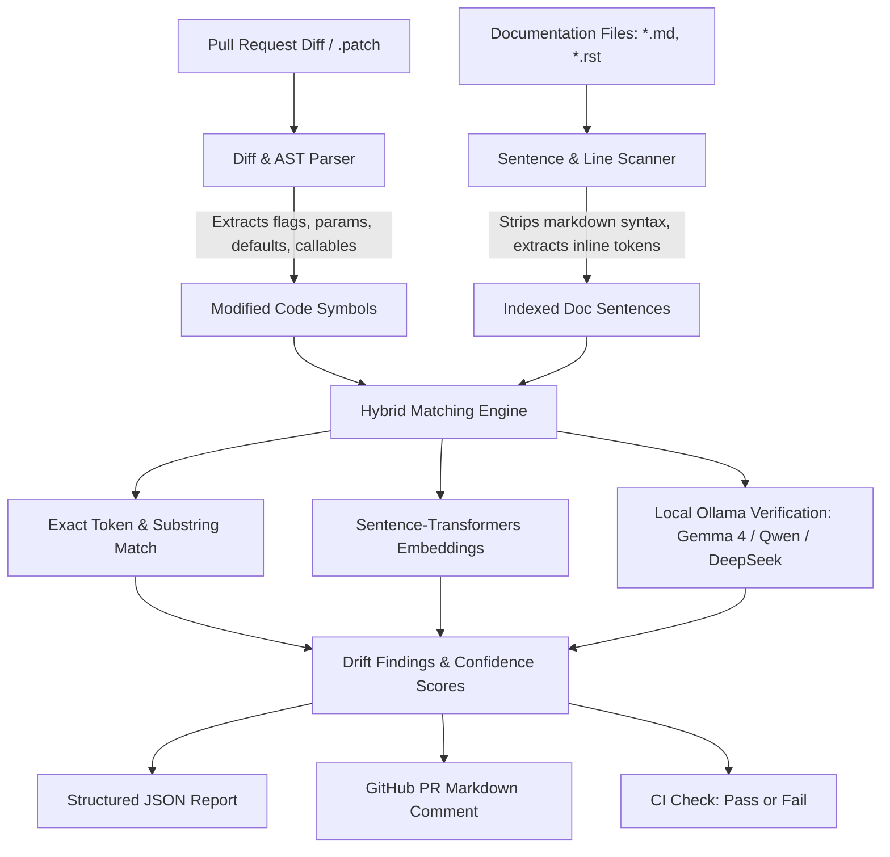

# Doc Drift Detector 🔍

> **Automated Documentation Drift Detection Engine**  
> Identifies documentation made inaccurate or obsolete by code modifications in a Pull Request, pointing directly to the exact sentence and responsible code line.

[](https://github.com/DakshG26/doc-drift/actions/workflows/ci.yml)
[](LICENSE)
[](https://www.python.org/)

---

## 🎯 The Problem

In software development, code evolves faster than documentation:
- A CLI argument or flag is renamed (e.g., `--timeout` → `--deadline`), but tutorials and README guides still instruct users to pass `--timeout`.
- A configuration default value changes (e.g., `timeout = 30` → `timeout = 60`), but architecture guides still claim the default is 30 seconds.
- A public API function or signature is modified or deprecated, but examples and markdown docs remain stale.

Traditional linters only validate whether code blocks compile; they cannot detect whether **explanatory natural language prose** matches actual code reality.

**Doc Drift Detector** closes this loop by analyzing Pull Request diffs, indexing documentation prose with line precision, and using hybrid AST parsing, semantic embeddings (`all-MiniLM-L6-v2`), and local open-weight LLMs (`gemma4:e4b`, `qwen`, `deepseek`) to catch documentation drift before merge.

---

## 🏗️ Architecture



---

## ✨ Key Capabilities

1. **Precision Sentence Citation**: Pinpoints the exact file and line number in documentation where stale text exists.
2. **Unified Diff & AST Awareness**: Extracts renamed flags (`argparse`, `click`), default values, function signatures, and constants.
3. **Hybrid Matching Strategy**:
   - **Exact Token Matching**: Zero false positives on literal flag names.
   - **Local Vector Embeddings (`all-MiniLM-L6-v2`)**: Detects paraphrased references without cloud dependencies.
   - **Local LLM Verification (`gemma4:e4b` / `qwen` / `deepseek` via Ollama)**: Deep contextual verification with natural language explanations.
4. **CI & Workflow Native**: Seamless integration via GitHub Actions, generating markdown summary tables in PR comments.

---

## 🚀 Quickstart

### 1. Installation

```bash
git clone https://github.com/DakshG26/doc-drift.git
cd doc-drift
pip install -r requirements.txt
```

### 2. Local CLI Usage

Inspect any `.patch` file against your repository documentation:

```bash
python -m doc_drift.github_action \
  --diff-file examples/input_pr_diff.patch \
  --docs-dir examples/docs \
  --output drift_report.json
```

### 3. 1-Click Auto-Repair (`--fix`)

Automatically patch and correct outdated documentation files in place:

```bash
python -m doc_drift.github_action \
  --diff-file examples/input_pr_diff.patch \
  --docs-dir examples/docs \
  --fix
```

### 4. Run the Open-Source Historical Benchmark Suite

Evaluate the detection engine against curated historical commits from Click, Flask, Requests, and Django:

```bash
python -m doc_drift.benchmark
```

```
=================================================================
📊 DOC DRIFT DETECTOR — HISTORICAL BENCHMARK SUITE
=================================================================
Total Evaluated Cases: 5
Accuracy:  100.0%
Precision: 100.0% (False Alarm Resistance)
Recall:    100.0% (Drift Catch Rate)
-----------------------------------------------------------------
Repository             | Expected | Found  | Status
-----------------------------------------------------------------
pallets/click          | 1        | 1      | PASS (True Positive)
pallets/flask          | 1        | 1      | PASS (True Positive)
psf/requests           | 1        | 1      | PASS (True Positive)
django/django          | 1        | 1      | PASS (True Positive)
control/negative-check | 0        | 0      | PASS (True Negative)
=================================================================
```

### 5. Direct GitHub URL Analysis

Analyze any public GitHub pull request or repository directly from the CLI or Web UI:

```bash
# Analyze a specific pull request
python -m doc_drift.github_action --url https://github.com/pallets/click/pull/2600

# Or shorthand
python -m doc_drift.github_action --url pallets/click#2600
```

### 6. Launch Interactive Visual Dashboard (`--ui`)

Start the interactive browser dashboard to paste any GitHub URL or test diffs side-by-side with confidence meters and 1-click AI fixes:

```bash
python -m doc_drift.github_action --ui
```

Visit `http://localhost:8765` in your browser. You can paste any GitHub link in the top bar and click **"🚀 Fetch & Analyze GitHub URL"**.

---

## 📊 Sample Output

### Markdown PR Comment:

| File | Line | Outdated Sentence | Modified Symbol | Code Origin | Confidence |
| :--- | :--- | :--- | :--- | :--- | :--- |
| `cli_reference.md` | 9 | You can specify `--timeout` in seconds to terminate stalled worker jobs before failure. | `--timeout` → `--deadline` | `worker/cli.py:40` | 96% |
| `cli_reference.md` | 10 | Default execution timeout is set to 30 seconds across all worker pools. | `default=30` → `default=60` | `worker/cli.py:40` | 96% |

### JSON Report (`drift_report.json`):

```json
{
  "drift_detected": true,
  "total_issues": 2,
  "findings": [
    {
      "doc_file": "cli_reference.md",
      "doc_line": 9,
      "stale_sentence": "You can specify `--timeout` in seconds to terminate stalled worker jobs before failure.",
      "changed_symbol": "--timeout",
      "new_symbol": "--deadline",
      "code_file": "worker/cli.py",
      "code_line": 40,
      "confidence": 0.96,
      "change_type": "renamed",
      "match_method": "exact"
    }
  ]
}
```

---

## 🤖 Open-Source AI Models Used

This project adheres strictly to offline, open-weight models with zero cloud API dependencies:

- **`gemma4:e4b` via Ollama**: Semantic reasoning and factual validation of documentation sentences against diff hunks.
- **`qwen` via Ollama**: Code AST and configuration parsing.
- **`deepseek` via Ollama**: Logical consistency and edge case verification.
- **`sentence-transformers/all-MiniLM-L6-v2`**: Local semantic vector embeddings for fast nearest-neighbor matching.

---

## 🧪 Testing

Run the test suite:

```bash
pytest tests/ -v
```

---

## 📄 License

Distributed under the [MIT License](LICENSE).
